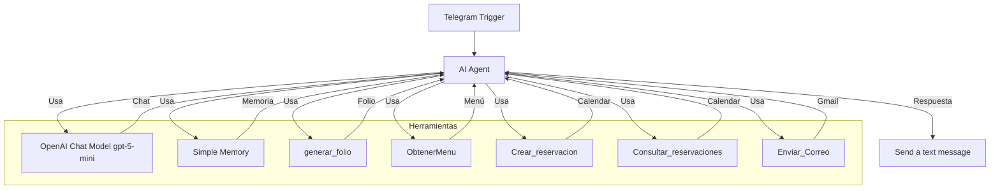

# Agente de Reservación - Tortolitos Desayunador

## Integrantes

| Nombre | Matrícula | Rol |
|--------|-----------|-----|
| Alan Franco Moraila | 24040319 | Arquitectura y Calidad |
| Angel Fernando Sandoval Rodriguez | 24040321 | Datos e integraciones |

## Escenario y problema que resuelve

El agente de IA funciona como recepcionista de Tortolitos Desayunador, un restaurante en Culiacán, atendiendo por Telegram. El problema que resuelve es automatizar el proceso de reservación de mesas: los clientes pueden consultar el menú, hacer reservaciones con un folio único, y recibir confirmación por correo, mientras el agente maneja el horario (martes a domingo 13:00-22:00), la capacidad máxima (15 personas) y las restricciones de grupo (máximo 10 por reservación).

## Diagrama del workflow (Mermaid)

*Captura del workflow en evidencias/workflow.png*

## Tabla de tools

| Nodo | Qué hace | Cuándo se usa | Lee | Escribe |
|------|----------|---------------|-----|---------|
| OpenAI Chat Model (gpt-5-mini) | Modelo de lenguaje que genera las respuestas del agente | Siempre, para procesar la entrada del usuario y decidir qué herramienta usar | No | No |
| Simple Memory | Memoria de ventana que conserva el contexto de la conversación | Cuando es necesario recordar parte del historial reciente | No | No |
| generar_folio | Genera un folio único con formato TD-XXXX | Justo antes de crear cada nueva reservación | No | No |
| ObtenerMenu | Consulta el menú completo del restaurante (platillos, bebidas, postres, precios, descripción, alérgenos y disponibilidad) | Cuando el usuario pregunta qué hay para comer o pide recomendaciones | No | No |
| Crear_reservacion | Crea una reservación en Google Calendar con folio generado automáticamente | Cuando el usuario confirma una reservación con fecha, hora y número de personas | No | Sí (Calendar) |
| Consultar_reservaciones | Consulta reservaciones existentes en un rango de fechas | Cuando el usuario quiere consultar su reservación ya hecha | No | No |
| Enviar_Correo | Envía un correo de confirmación por Gmail | Después de crear la reservación en el calendario | No | Sí (Gmail) |

**Nota importante: No hay tools de modificar o cancelar reservaciones.** El agente solo puede crear nuevas reservaciones y consultar las existentes. Para modificar o cancelar, se indica al usuario que contacte al personal directamente.

## Stack por capa

| Capa | Tecnología | Por qué se eligió |
|------|------------|-------------------|
| Modelo | OpenAI gpt-5-mini | Modelo conversacional rápido y económico, integrado en n8n vía AI Agent |
| Memoria | Simple Memory (Buffer Window) | Mantiene contexto de conversación a corto plazo en la misma sesión |
| Datos | Google Calendar + Google Sheets | Calendar para reservaciones con folios, Sheets para menú consultable |
| Canal | Telegram | Comunicación directa con el cliente en su plataforma de mensajería |
| Acciones | Code Tool (folio), Gmail (confirmación), Calendar (reservación) | Operaciones específicas: generar folio único, confirmar por correo, guardar en agenda |

## Cómo ponerlo a funcionar

1. **Credenciales a crear:**
   - **Telegram bot:** Crear un bot con @BotFather y obtener el token
   - **OpenAI:** Configurar la API key en n8n para el nodo OpenAI Chat Model (gpt-5-mini)
   - **Google OAuth para Calendar, Sheets y Gmail:** Configurar OAuth2 en n8n (en modo Testing, el token caduca a los 7 días)

2. **Estructura de la hoja del menú:** La hoja de Google Sheets debe tener las columnas: Platillo, Categoría, Precio, Descripción, Alérgenos, Disponible (como el archivo menu_tortolitos.csv incluido)

3. **Calendario a usar:** El calendario "pruebas.isof@gmail.com" ya está configurado en las credenciales de n8n

4. **Importar el JSON:** En n8n, usar menú → Import → From File y seleccionar workflows/01-agente.json

5. **Activar el workflow:** Encender el interruptor de ejecución en la esquina superior derecha de n8n

6. **Consideraciones para Telegram en n8n local:** Es necesario una URL pública con HTTPS (puede usar ngrok o similar) para que el webhook de Telegram funcione correctamente. El bot token debe configurarse en las credenciales de n8n.

7. **Limitaciones de Testing:** El token OAuth de Google en modo Testing caduca a los 7 días, después hay que regenerar las credenciales.

## Casos de prueba y evidencias

Los 10 casos de prueba y sus resultados están en `casos.csv` (4 happy_path, 2 borde, 1 memoria, 1 escritura y 2 fuera de alcance). Las capturas de cada ejecución en Telegram están en `evidencias/caso-01.png` a `evidencias/caso-10.png`.

Para reproducirlos: abre una conversación con el bot en Telegram, envía la `entrada` de cada caso del CSV y compara la respuesta con el `comportamiento_esperado`, llenando las columnas `respuesta_obtenida`, `tool_usada` y `pasa`.

## Limitaciones conocidas

- No hay tools para modificar o cancelar reservaciones existentes
- La memoria se pierde al reiniciar el workflow
- La capacidad máxima es de 15 personas simultáneas y grupos mayores a 10 deben contactar al personal
- El token OAuth de Google caduca a los 7 días en modo Testing
- Telegram requiere URL pública HTTPS para funcionar en modo local